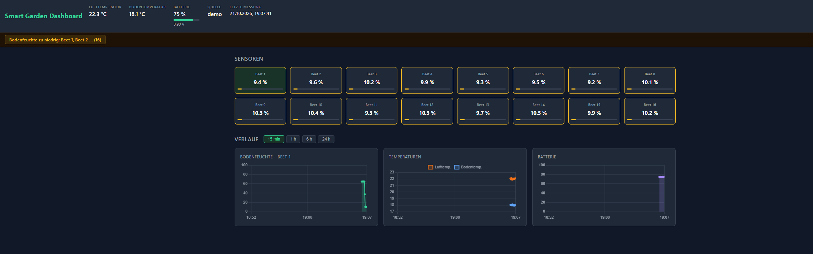

# Smart Garden Dashboard

Lokales Backend und Web-Dashboard für das Smart-Garden-Projekt im Kurs *Current Technologies* (MCI).
Die zugehörige Hardware ist ein STM32 Nucleo-L476RG mit FreeRTOS, der bis zu 16 kapazitive
Bodenfeuchte-Sensoren (4 × ADS1115 ADC, je 4 Kanäle) sowie Luft-/Bodentemperatur und
Batteriespannung als JSON-Zeilen über UART sendet.

Dieses Repository ist das Ergebnis einer **Vibe-Coding-Hausübung**: Der Anwendungscode und die
Tests wurden per Vibe Coding mit Claude Code erzeugt. Kontextdatei (AGENTS.md/CLAUDE.md),
Prompt-Plan (PROMPTS.md), Berichtsvorlage und das Skript `tools/jsonl_to_md.py` wurden vorab mit
Hilfe eines KI-Chats vorbereitet; einzelne Zeilen (z. B. in `.gitignore` und `CLAUDE.md`) wurden
manuell ergänzt. Die verwendeten Prompts und ein Erfahrungsbericht stehen in
[`PROMPTS.md`](PROMPTS.md) und [`VIBE_CODING.md`](VIBE_CODING.md).



---

## Voraussetzungen

| Anforderung | Mindestversion |
|---|---|
| Python | 3.11 (getestet mit 3.14; ab 3.11 vorgesehen, aber nicht auf älteren Versionen geprüft) |
| pip | beliebig (im venv enthalten) |
| Internet | nur für Chart.js (CDN, kein lokales Bundle) |

Ohne Internetverbindung werden die Diagramme nicht gerendert; alle anderen Funktionen
(Backend, API, Simulator) laufen offline.

---

## Installation und Start

### Windows (PowerShell)

```powershell
# 1. Repository klonen
git clone https://github.com/mimo3a/smart-garden-dashboard.git smart-garden-dashboard
cd smart-garden-dashboard

# 2. Virtuelle Umgebung anlegen und Abhängigkeiten installieren
python -m venv .venv
.\.venv\Scripts\Activate.ps1
pip install -r requirements.txt

# 3. App starten (Simulator-Modus – keine Hardware nötig)
python -m app.main

# 4. Browser öffnen
start http://127.0.0.1:8000
```

### Linux / macOS

```bash
# 1. Repository klonen
git clone https://github.com/mimo3a/smart-garden-dashboard.git smart-garden-dashboard
cd smart-garden-dashboard

# 2. Virtuelle Umgebung anlegen und Abhängigkeiten installieren
python3 -m venv .venv
source .venv/bin/activate
pip install -r requirements.txt

# 3. App starten
python -m app.main

# 4. Browser öffnen
xdg-open http://127.0.0.1:8000   # Linux
open http://127.0.0.1:8000        # macOS
```

### Start-Varianten

| Befehl | Beschreibung |
|---|---|
| `python -m app.main` | Simulator-Modus (keine Hardware erforderlich) |
| `python -m app.main --demo` | Demo-Modus: durchläuft alle 7 Alarm-Szenarien (~3 min/Zyklus) |
| `python -m app.main --port COM5` | UART-Modus, Windows (z. B. COM5) |
| `python -m app.main --port /dev/ttyACM0` | UART-Modus, Linux |
| `python -m app.main --port COM5 --baud 115200` | UART mit expliziter Baudrate (Standard: 115200) |
| `python -m app.main --host 0.0.0.0` | Im Netzwerk erreichbar (alle Interfaces) |
| `python -m app.main --db mein-garten.db` | Abweichender Datenbankpfad (Standard: `garden.db`) |
| `python -m app.main --keep-days 14` | Ältere Messwerte beim Start löschen (Standard: 7 Tage) |

---

## Datenformat der Firmware

Die Platine sendet pro Messung eine JSON-Zeile über UART (115200 Baud, `\n`-terminiert):

```json
{
  "channels": [
    {"dev": 0, "ch": 0, "status": 0, "raw": 15234},
    {"dev": 0, "ch": 1, "status": 0, "raw": 14980},
    {"dev": 0, "ch": 2, "status": 1, "raw": 0},
    {"dev": 1, "ch": 0, "status": 0, "raw": 25351}
  ],
  "air_temp_c": 22.4,
  "soil_temp_c": 18.1,
  "battery": {"voltage": 3.91, "percent": 76}
}
```

| Feld | Typ | Bedeutung |
|---|---|---|
| `channels` | Array | Bis zu 16 Bodenfeuchte-Kanäle (4 ADS1115 × 4 Kanäle) |
| `dev` | int 0–3 | ADS1115-Geräteindex |
| `ch` | int 0–3 | Kanal am Gerät |
| `status` | int | `0` = ok, alles andere = Sensorfehler |
| `raw` | int 0–32767 | ADS1115-Rohwert; wird per Kalibrierung in % umgerechnet |
| `air_temp_c` | float | Lufttemperatur in °C (optional) |
| `soil_temp_c` | float | Bodentemperatur in °C (optional) |
| `battery.voltage` | float | Batteriespannung in V (optional) |
| `battery.percent` | float 0–100 | Ladestand in % (optional) |

Zeilen, die kein gültiges JSON enthalten (z. B. Bootmeldungen wie `USART1 PA9 OK`),
werden verworfen und stürzen die App nicht ab.

Die Feuchte-Umrechnung erfolgt linear pro (dev, ch) aus `config.json`:

```
moisture_pct = (dry_raw − raw) / (dry_raw − wet_raw) × 100
```

Ergebnis wird auf 0–100 % geklemmt. Unbekannte (dev, ch)-Kombinationen liefern `moisture_pct = null`.

---

## REST-API

Alle Endpunkte liefern JSON. Die statischen Dateien (`/`, `/app.js`, `/style.css`) werden
unter derselben Adresse ausgeliefert; API-Routen haben immer Vorrang.

### `GET /api/latest`

Letzte Messung mit allen Kanälen und aktiven Alarmen.  
Gibt `404` zurück, solange noch keine Messung vorliegt.

```json
{
  "ts": "2025-06-01T12:00:00+00:00",
  "source": "simulator",
  "air_temp_c": 22.4,
  "soil_temp_c": 18.1,
  "battery_voltage": 3.91,
  "battery_percent": 76.0,
  "channels": [
    {"dev": 0, "ch": 0, "raw": 15234, "status": "ok", "moisture_pct": 77.0},
    {"dev": 0, "ch": 1, "raw": 25351, "status": "ok", "moisture_pct": 4.6}
  ],
  "alerts": [
    {
      "type": "soil_moisture_low",
      "severity": "warning",
      "message": "Bodenfeuchte zu niedrig: Beet 2 (4.6 %)",
      "dev": 0,
      "ch": 1
    }
  ]
}
```

### `GET /api/history?minutes=60&max_points=300`

Zeitlich gebuckelte Messwerte der letzten `minutes` Minuten (1–1440).
Enthält mehr Punkte als `max_points` (10–1000), wird in SQL gemittelt.
Kanäle mit `status = "err"` werden in den Bucket-Mittelwerten nicht berücksichtigt.

```json
[
  {
    "ts": "2025-06-01T11:45:00+00:00",
    "air_temp_c": 21.8,
    "soil_temp_c": 17.9,
    "battery_percent": 76.2,
    "channels": [
      {"dev": 0, "ch": 0, "moisture_pct": 76.5}
    ]
  }
]
```

### `GET /api/config`

Aktuelle Kalibrierung und Schwellwerte aus `config.json`.  
Gibt `500` zurück, wenn die Datei nicht gelesen werden kann.

---

## Alarmregeln

Alarme werden bei jedem Aufruf von `/api/latest` live aus `config.json` berechnet.
Der Grenzwert selbst löst **keinen** Alarm aus (strikt `<` bzw. `>`).
Fehlende Werte (`null`) erzeugen ebenfalls keinen Alarm.

| Typ | Auslöser | Schwere |
|---|---|---|
| `soil_moisture_low` | Bodenfeuchte < `soil_moisture_min_percent` | warning |
| `sensor_error` | Kanal mit `status = "err"` | error |
| `air_temp_low` | Lufttemperatur < `air_temp_min_c` | warning |
| `air_temp_high` | Lufttemperatur > `air_temp_max_c` | warning |
| `soil_temp_low` | Bodentemperatur < `soil_temp_min_c` | warning |
| `soil_temp_high` | Bodentemperatur > `soil_temp_max_c` | warning |
| `battery_low` | Ladestand < `battery_min_percent` | warning |

---

## Konfiguration (`config.json`)

```json
{
  "sensors": [
    {"dev": 0, "ch": 0, "name": "Beet 1", "dry_raw": 26000, "wet_raw": 12000}
  ],
  "thresholds": {
    "soil_moisture_min_percent": 30,
    "air_temp_min_c": 5,
    "air_temp_max_c": 35,
    "soil_temp_min_c": 5,
    "soil_temp_max_c": 30,
    "battery_min_percent": 20
  }
}
```

Die Datei wird im laufenden Betrieb bei jeder Änderung (mtime) automatisch neu geladen.
Tritt beim Laden ein Fehler auf, behält das Backend den zuletzt gültigen Stand und versucht
es beim nächsten Aufruf erneut.

---

## Tests ausführen

```powershell
# Windows
.\.venv\Scripts\Activate.ps1
pytest -q
```

```bash
# Linux / macOS
source .venv/bin/activate
pytest -q
```

Alle Tests laufen ohne laufenden Server und ohne physische Hardware; die Datenbank wird als
temporäre SQLite-Datei im vom Test-Framework bereitgestellten `tmp_path` angelegt.

---

## Bekannte Grenzen

- **Zeitachsen-Beschriftung:** Chart.js zeigt bei breiten Zeitfenstern (≥ 6 h) nur 2–3 Tick-Labels,
  was auf sehr kleinen Bildschirmen unübersichtlich wirken kann.
- **Simulator-Zustand nach Neustart:** Der Simulator startet mit zufälligem Anfangszustand
  (Feuchte, Temperatur, Batterieladestand) und weicht daher von einem vorherigen Lauf ab.
- **Frontend ohne automatisierte Tests:** Die JavaScript-Logik (Diagramme, Alarmleiste,
  Sensor-Karten) wird ausschließlich manuell im Browser getestet.
- **Chart.js benötigt Internet:** Die Diagrammbibliothek wird von einem CDN geladen;
  ohne Netzverbindung bleibt der Diagramm-Bereich leer.
- **Teilweise doppelte Test-Helfer:** `make_reading` ist in `test_alerts.py` und
  `test_main.py` unabhängig voneinander definiert; eine gemeinsame `conftest.py`-Fixture
  würde Duplikationen vermeiden.
- **Alarme werden nicht zwischengespeichert:** `/api/latest` berechnet Alarme bei jedem
  Aufruf neu aus der Datenbank und `config.json`; bei sehr häufigen Polls (< 1 s)
  und großen Sensor-Arrays kann das messbar werden.

---

## Weiterführende Dokumente

| Datei | Inhalt |
|---|---|
| [`PROMPTS.md`](PROMPTS.md) | Alle verwendeten Prompts (Aufgaben 1–8 + Review) |
| [`VIBE_CODING.md`](VIBE_CODING.md) | Erfahrungsbericht zum Vibe-Coding-Prozess |
| [`docs/claude-session-1.md`](docs/claude-session-1.md) | Sitzungsprotokoll Session 1 (Prompts 1–4) |
| [`docs/claude-session-2.md`](docs/claude-session-2.md) | Sitzungsprotokoll Session 2 (Prompts 5–7) |
